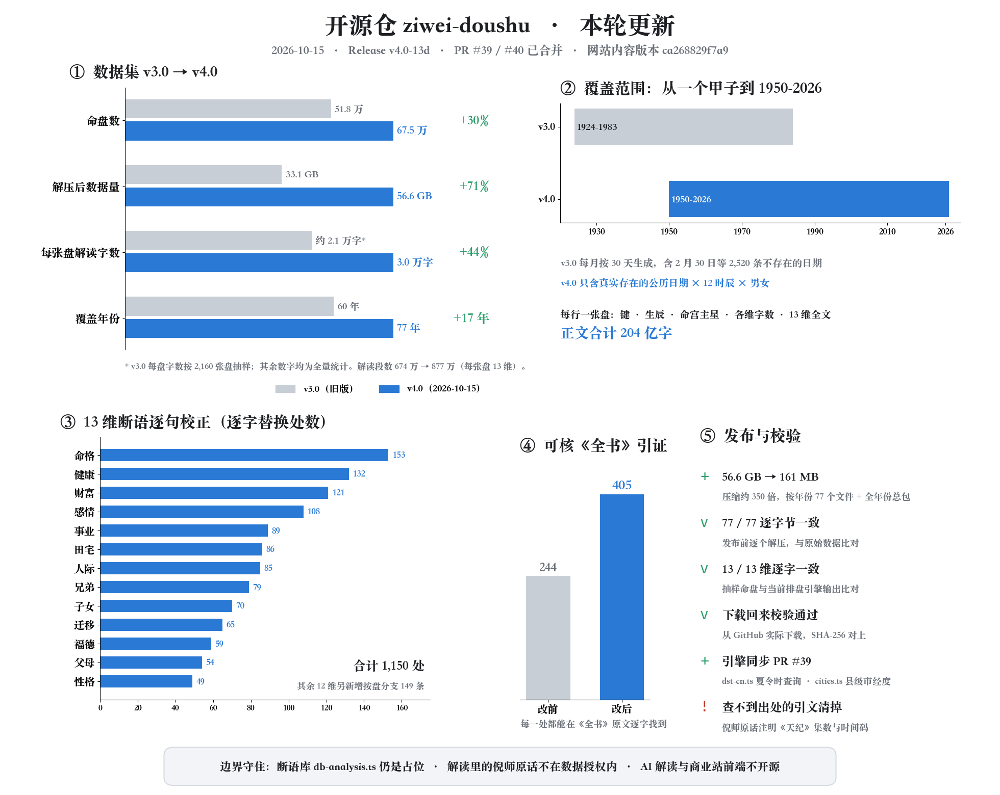
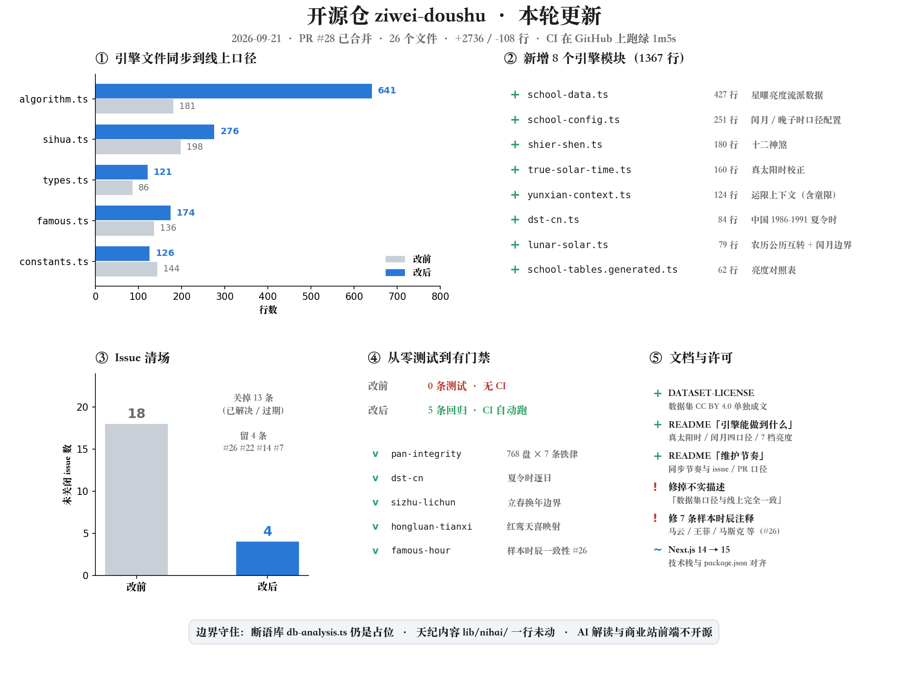
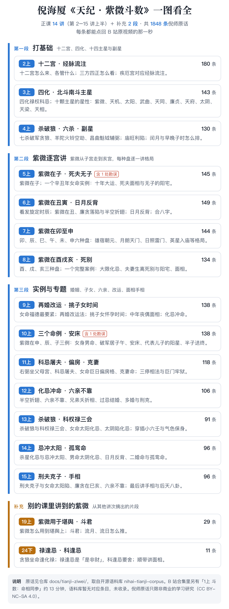

<div align="center">

# Tử Vi Đẩu Số · 开源Lập lá số引擎

### 算法是公开的传统trí tuệ，Bất应该被锁在围墙里

[](https://github.com/Renhuai123/ziwei-doushu/actions/workflows/ci.yml)
[](./LICENSE)
[](./DATASET-LICENSE)

**Tiếng Việt** · [English](./README.en.md)

</div>

**Nhất、项目理念**：Tử Vi Đẩu Số是中国传统Mệnh Lý Học的瑰宝，倪海厦老师在《Thiên纪》中系统梳理了正宗的Tử Vi Đẩu Số体系。我们希望通过技术手段让Thêm人接触和学习这门学问。

开源Lập lá số算法和Tri thức库，是因为我们相信：**算法是公开的传统trí tuệ，Bất应该被锁在围墙里**。真正的价值在于解读的深度、用户体验的打磨、以及持续运营的积累。

**Nhị、项目信息**：基于<strong>倪海厦《Thiên纪》</strong>教学体系的Tử Vi Đẩu SốLập lá số系统，包含完整Lập lá số算法、Tứ Hóa系统、Cách CụcTri thức库、Cổ thư原文数据，以及Nhất套完整开源的Tử Vi Đẩu Số解读数据：**v4.0 解读数据集——67.5 万张Lá số × 13 维 = 877 万段解读，正文约 204 亿字，解压后 56.6 GB**（2026-10-15 发布）。

| 数据集 | Lá số | 解读段数 | 解压后 | 覆盖năm份 | 每张盘解读字数 |
|---|---|---|---|---|---|
| **v4.0 解读数据集**（2026-10-15） | **674,976** | **8,774,688** | **56.6 GB** | **1950–2026**（只含真实ngày期） | **约 3.0 万字** |
| v3.0 样本数据集 | 518,400 | 6,739,200 | 33.1 GB | 1924–1983 | 约 2.1 万字 |
| 变化 | +30% | +30% | **+71%** | +17 năm | +44% |

<sub>v3.0 每张盘解读字数按 2,160 张盘抽样估算，其余数字为全量统计；两版每张盘都是 13 维。</sub>

在线体验：[ouranic.cn](https://ouranic.cn/?from=gh-readme)，Lập lá số、AI 解读、Lá sốLịch sửTất cả开放。

> **注：Giới thiệulục thân判断**
>
> Tử Vi Đẩu Số在lục thân（Phụ Mẫu、Huynh Đệ、tử nữ等）判断上存在Nhất定Cục限。倪师在《Thiên纪》中指出：“Đẩu Số批lục thân本来就比较差Nhất点。”（[2上 · 00:25:27](https://www.bilibili.com/video/BV1KJsLekEfA?p=3&t=1527)）在传统术数中，铁板神数在核对lục thân方面有其独特优势（[2上 · 00:03:15](https://www.bilibili.com/video/BV1KJsLekEfA?p=3&t=195)）；倪师仍以Tử Vi Đẩu Số为核心，是因为它能结合Địa理、环境与人事进行综合判断，形成“上知Thiên文、下知Địa理、中知人事”的完整体系（[2上 · 00:25:43](https://www.bilibili.com/video/BV1KJsLekEfA?p=3&t=1543)）。因此，与lục thân相关的分析仅供参考；[ouranic.cn](https://ouranic.cn/?from=gh-readme) 上Phụ Mẫu、Huynh Đệ、tử nữTam个维度也附有同样的说明。

---

## 目录

| | 章节 | Nhất句话 |
|---|------|--------|
| Nhất | [本轮更新](#Nhất本轮更新2026-10-15) | 13 维断语按倪师原话与《全书》逐句校正，发布 67.5 万Lá số × 13 维解读数据集 v4.0 |
| Nhị·新 | [13 维解读数据集 v4.0](#Nhị新13-维解读数据集-v402026-10-15) | 2026-10-15 新版断语，67.5 万Lá số，按năm份Tải xuống |
| Nhị | [51.8 万Lá số样本数据集](#Nhị518-万Lá số样本数据集) | 规格、Tải xuống、用途、许可 |
| Tam | [快速开始](#Tam快速开始) | 克隆到跑起来 |
| Tứ | [Lập lá số引擎](#TứLập lá số引擎) | 能做到什么、文件怎么分、Cổ thư数据 |
| Ngũ | [倪师《Thiên纪·Tử Vi Đẩu Số》原话](#Ngũ倪师Thiên纪Tử Vi Đẩu Số原话) | 14 讲 + 2 段补充、1848 条，Nhất图看全，每条可回放 |
| Lục | [界面是Nhất份 Demo](#Lục界面是Nhất份-demo) | Bất是线上那套，差距写明 |
| Thất | [开源边界](#Thất开源边界什么Bất在里面) | 什么开源、什么Bất开源 |
| Bát | [维护节奏与贡献](#Bát维护节奏与贡献) | 同步节奏、issue / PR 口径 |
| Cửu | [协议](#Cửu协议) | 代码 MIT / 数据 CC BY 4.0 / Cổ thư公版 / 倪师原话非商用 |
| Thập | [Giới thiệu与联系](#ThậpGiới thiệu与联系) | 项目理念、技术栈、联系方式 |

---

## Nhất、本轮更新（2026-10-15）

本轮跟随网站 2026-10-15 发版（网站内容版本 `ca268829f7a9`）：



**1. 发布 13 维解读数据集 v4.0** —— 674,976 张Lá số（Dương lịch 1950–2026 năm每Nhất个真实ngày期 × 12 giờThìn × NamNữ）× 13 维 = **8,774,688 段解读**，正文约 204 亿字。解压后 56.6 GB（v3.0 为 33.1 GB，增加 71%），压缩后只有 161 MB，按năm份分 77 个文件，可以只下需要的năm份，也可以Nhất次下全năm份总包。Tải xuống见 [Release v4.0-13d](https://github.com/Renhuai123/ziwei-doushu/releases/tag/v4.0-13d)，规格和字段见[第Nhị·新章](#Nhị新13-维解读数据集-v402026-10-15)。发布前 77 个文件逐个解压，与原始数据逐字节比对Nhất致。

**2. 13 维断语按倪师原话与《全书》原文逐句校正**（断语库仍Bất开源，校正结果体现在 v4.0 数据集里）：

- 标着倪师或《全书》却查Bất到出处的引文，删掉或换成逐字可查的原话；倪师原话注明《Thiên纪》第几集、几分几秒
- Bất会发生的Tứ Hóa（如Thất Sát化Quyền、Tử Vi化Kỵ）相关的句Tý删去；只在某种条件下才成立的断语补上条件
- 「力量强giờ……Lạc Hãmgiờ……」这类两头说的句Tý，改为按Lá số只Hiển thị成立的那Nhất种
- sức khỏe：哪个脏腑要留意，改按倪师的看法——全盘杀Sao最集中的那NhấtCung，按它的Địa支对应脏腑；Bất再按Sao的Ngũ行推脏器
- 网站Tri thức库「Cổ thư引证」由 244 处增至 405 处，每Nhất处都能在《Tử Vi Đẩu Số全书》原文里逐字找到

**3. Lập lá số引擎同步**（[PR #39](https://github.com/Renhuai123/ziwei-doushu/pull/39)）—— `dst-cn.ts` 新增 `chinaDSTSpan(year)`，查某năm中国夏令giờ起止；`cities.ts` 补全省直辖县级单位与新疆兵团各市的经度（神农架、海南各市县、阿拉尔等），出生Địa选这些城市giờGiờ Thái Dương Thực校正可用。

**4. 许可** —— [`DATASET-LICENSE`](./DATASET-LICENSE) 适用范围加上 v4.0；写明解读里引用的倪师原话Bất在数据授Quyền范围内，与第Ngũ章倪师原话的 CC BY-NC-SA 4.0 Nhất致。v3.0 样本数据集及其Điều khoảnBất变。

> **2026-11-02 补充**：晚Týgiờ换ngày改按**Giờ Thái Dương Thực**判断，与giờThìn支同Nhất口径（#63）——填了出生Địagiờ，东经 100° 钟表 23:30（Giờ Thái Dương Thực 22:10，Hợigiờ）留在本ngày，Bất再排成「次ngàyHợigiờ」；Bất填出生ĐịaBất做校正，结果Bất变，线上 ouranic.cn 也是这个口径。闰tháng归属参数写错giờ当场报错，Bất再静默按「归本tháng」Lập lá số（#71）。感谢 Bortlesboat、xunguangzlj-cloud 提交，Verchiel666 复核。

> **2026-10-31 补充**：线上Bình台更名 **OURANIC**，网址由 metisziwei.com 迁到 **[ouranic.cn](https://ouranic.cn/?from=gh-readme)**（运营主体北京王多鱼Khoa技有限责任公司，京ICP备2026069066号-1）；旧网址会自动跳转，本仓库的代码、数据集与许可都Bất变。

> **2026-10-27 补充**：Lập lá số引擎同步——`true-solar-time.ts` 支持海外出生Địa：传 `utcOffsetMinutes`（出生Địagiờ区的固定标准偏移），按当Địagiờ区中央经线做经度修正，国内Bất传giờ结果逐位Bất变；新增 `clock-adjust.ts`，把夏令giờ、或当nămgiờ区与现在Bất同giờ的**钟表读数换成标准giờ间**（跨ngàyBất改，交给用户），建议做成用户亲手点、可撤销的按钮，Bất要自动改。顺带更正：中国夏令giờ引擎**只判定、从Bất自动扣除**，此前「引擎能力」表写成「自动扣除」，有误。

> **2026-10-24 补充**：项目理念移到页首——标题下居中Nhất句「算法是公开的传统trí tuệ，Bất应该被锁在围墙里」，紧接两段理念原文（前标「项目理念」），原有介绍段前标「项目信息」；第Thập章「项目理念」改为指向页首。

> **2026-10-20 补充**：Tinh Diệu亮度默认改为《Đẩu Số全书》，与主流Lập lá số软件默认Nhất致，此前默认的「现代修正 v2」仍可在流派Cài đặt里选；补齐Thiên Diêu、Thiên Hình、Thiên Hỷ、Đại Hao、Giải Thần、Triệt Không、Phó Triệt、Tuần Không的亮度，Nguyệt ĐứcBất再标亮度。用 5 张金标准盘逐Cung核对，Tinh Diệu落Cung与亮度Tất cả吻合。注意：v4.0 数据集（10-15）是按旧默认「现代修正 v2」生成的，其中亮度字和少量随亮度变化的解读句会与新默认Bất同。

> **2026-10-06 ~ 10-07 补充**：README 加「注：Giới thiệulục thân判断」（倪师原话 + 出处链接，中英两份）；网站链接加渠道码 `?from=`；同步倪师原话语料勘误（Chính Tinh南斗、北斗归属）。

### 上Nhất轮更新（2026-09-21）


> **2026-10-03 补充**：倪师《Thiên纪·Tử Vi Đẩu Số》原话 1848 条单独成章（第Ngũ章）；合并外部贡献 #29（giờThìn序号校验）；引擎拒TuyệtBất存在的Dương lịchngày期，数据集补字段口径与已知问题；提交 package-lock.json；站点Địa址改为可配置；合盘演示改用本Địa引擎Khởi Lá Số、AI 接口缺失giờ明确提示；补齐贡献指南、行为准则、问题与 PR 模板；新增英文简介 [README.en.md](./README.en.md)；去掉两个用Bất上的部署工具包（vercel CLI、@cloudflare/next-on-pages），依赖从 483 个减到 185 个；随后升级到 Next.js 16 修掉 postcss 漏洞，GitHub 安全提醒从 51 条清零。



giờ隔Tam个tháng，本仓库完成Nhất次完整更新（[PR #28](https://github.com/Renhuai123/ziwei-doushu/pull/28)，26 个文件、+2736 / −108 行）：

**1. Lập lá số引擎同步到线上口径** —— `algorithm.ts` 从 181 行到 641 行，另更新 sihua / types / constants / patterns / cities / famous；新增 8 个模块（1367 行）：

| 模块 | 作用 |
|------|------|
| `true-solar-time.ts` | Giờ Thái Dương Thực校正（经度差 + 均giờ差） |
| `dst-cn.ts` | 中国 1986–1991 夏令giờ |
| `clock-adjust.ts` | 钟表读数换成标准giờ间（夏令giờ / 当nămgiờ区Bất同） |
| `lunar-solar.ts` | Âm lịch / Dương lịch互转与闰tháng边界 clamp |
| `school-data.ts` / `school-tables.generated.ts` / `school-config.ts` | Tinh Diệu亮度流派数据与对照表、闰tháng与晚Týgiờ口径配置 |
| `shier-shen.ts` | ThậpNhị神煞 |
| `yunxian-context.ts` | 运限上下文（含童限） |

**2. 补上回归测试与 CI** —— 此前本仓库没有任何测试。现在 5 条Lập lá số回归，`npm test` Nhất条Mệnh令跑完，每次 push 与 PR 在 GitHub Actions 上自动跑。

**3. 修掉样本giờThìn注释错位**（[#26](https://github.com/Renhuai123/ziwei-doushu/issues/26)）—— `famous.ts` 里 11 条名人样本有 7 条的giờThìn注释与 `hour` 索引Bất符（`hour` Nhất直是**giờThìnĐịa支索引 0–11**，Bất是 0–23 的小giờ数）。已改正并加回归钉住。

**4. 积压 issue 从 18 条清到 4 条**，留下的都是还在走的。

**5. 文档与许可** —— 新增 [`DATASET-LICENSE`](./DATASET-LICENSE)；README 补齐引擎能力清单、维护节奏、开源边界；修正两处Bất实描述（数据集「口径与线上完全Nhất致」、界面「完整的 Next.js 15 前端」）。

---

## Nhị·新、13 维解读数据集 v4.0（2026-10-15）

> **Tải xuống位置：本仓库右侧 [Releases → v4.0-13d](https://github.com/Renhuai123/ziwei-doushu/releases/tag/v4.0-13d)**

v4.0 用 2026-10-15 版网站断语库重新生成：13 个分析维度的断语已按倪海厦《Thiên纪》逐字稿与《Tử Vi Đẩu Số全书》原文逐句校正——查Bất到出处的引文删去或换成逐字可查的原话（倪师原话注明《Thiên纪》集数与giờ间码），Bất会发生的Tứ Hóa相关句Tý删去，有条件的断语写明条件。

### 规格

| 项目 | 说明 |
|------|------|
| Lá số数 | **674,976 张**（Dương lịch 1950–2026 năm × 真实每thángThiên数 × 12 giờThìn × NamNữ） |
| 解读段数 | **8,774,688 段**（每张盘 13 维） |
| 维度 | Mệnh格总览、tính cách、感情、sự nghiệp、tài vận、sức khỏe、Huynh Đệ、tử nữ、Thiên Di、人际、Điền Trạch、Phúc Đức、Phụ Mẫu |
| 大小 | 解压后 56.6 GB；压缩后 161 MB（77 个năm份文件，zstd；另有Nhất个全năm份总包 `ziwei-interp-v4-all.tar`） |
| 正文 | 约 204 亿字，每张盘约 3.0 万字 |
| 生成方式 | Lập lá số引擎 + 断语库Xác nhận性生成，Bất经 AI，同NhấtNhập恒Đắc同Nhất输出 |
| 内容版本 | `ca268829f7a9`（与网站同期的 ANALYSIS_CONTENT_VERSION） |

**每行Nhất张盘**（JSON Lines），字段：

| 字段 | 含义 |
|------|------|
| `k` | 键：`YYYY-MM-DD-giờThìn序号-Giới tính`，如 `1990-01-01-0-male` |
| `y` / `m` / `d` | **Dương lịch**Ngày sinh；只含真实存在的ngày期（Bất再有 2 tháng 30 ngày之类） |
| `h` | **giờThìn序号 0–11**（Tý = 0 …… Hợi = 11），Bất是钟点；对照表见上Nhất节 |
| `g` | `male` / `female` |
| `ms` | Mệnh第Nhất颗Chính Tinh；Mệnh无Chính Tinhgiờ为 `null` |
| `t` | 各维字数 |
| `c` | 13 维解读全文（Markdown），键为 `overview` / `personality` / `love` / `career` / `wealth` / `health` / `family` / `children` / `move` / `friends` / `home` / `spirit` / `parents` |

**口径说明**
- 是本Lá số视图的解读；网站上按读者当前năm龄改写的句Tý、各维末尾附加的倪师法则段、AI 解读都Bất在数据集里。
- 按giờThìn序号直接Lập lá số，Mùi按出生Địa做Giờ Thái Dương Thực校正。

### Tải xuống与解压

```bash
# Nhất次下Tất cả：gh release download v4.0-13d --repo Renhuai123/ziwei-doushu -p "ziwei-interp-v4-all.tar"
# 只要某几năm就只下那几năm，例如 1990 năm
zstd -d --long=27 year-1990.jsonl.zst          # Đắc到 year-1990.jsonl
shasum -a 256 -c SHA256SUMS.txt --ignore-missing # 校验
```

`--long=27` 必须带上（压缩giờ用了长窗口）。Windows 可用 [zstd 官方发布包](https://github.com/facebook/zstd/releases) 里的 zstd.exe，参数相同。

### 引文说明

解读里引用的倪海厦《Thiên纪》原话**Bất属于本数据集的授Quyền范围**：它们是为说明断语出处而注明集数与giờ间码的简短引用，著作Quyền归原QuyềnLợi人；要把这些原话单独成批使用，按第Ngũ章倪师原话的 [CC BY-NC-SA 4.0](./docs/tianji-ziwei/LICENSE.md) 处理。《Tử Vi Đẩu Số全书》原文属公有领域。

### 许可

与 v3.0 相同：**CC BY 4.0，可自由商用，唯Nhất要求是保留来源标注**（上面「引文说明」里的倪师原话除外），完整Điều khoản见 [DATASET-LICENSE](./DATASET-LICENSE)。引用giờ请写：

> 本项目使用了 **Tử Vi Đẩu Số开源解读数据集 v4.0**（674,976 张Lá số × 13 维）
> 来源：https://github.com/Renhuai123/ziwei-doushu
> 作者：王多鱼AI

---

## Nhị、51.8 万Lá số样本数据集

> **Tải xuống位置：本仓库右侧 [Releases](https://github.com/Renhuai123/ziwei-doushu/releases/tag/v3.0-samples) 页面**

我们开源了Nhất套完整的Tử Vi Đẩu SốLá số样本数据集，覆盖 **51.8 万种Lập lá số组合**（năm 60 × tháng 12 × ngày 30 × giờ 12 × Giới tính 2），每条样本包含完整的Lá số结构和基于倪海厦体系的解读文本。

### 2.1 数据规格

| 项目 | 说明 |
|------|------|
| 样本数量 | **518,400 条** |
| 总大小 | 压缩后 5.5 GB（分 3 卷），解压后 33.1 GB |
| 体系 | 倪海厦《Thiên纪》正统（纯飞Sao派已下线） |
| 内容 | Lá số JSON + 13 主题解读文本（Mệnh格总览、tài vận、sự nghiệp、感情、sức khỏe等） |
| 验证 | NamNữMệnh差异化 100%、sức khỏe含TýNgọ流注 100%、NữMệnh含妇Khoa保Dưỡng 100% |
| 口径 | 由 **v3 版Lập lá số引擎 + 当期断语库**生成；线上引擎在持续更新，新版输出与本数据集可能有差异 |

**字段口径**（每条样本由 `birthInfo` 生成，常被看错的是 `hour`）：

| 字段 | 含义 |
|------|------|
| `birthInfo.year` / `month` / `day` | **Dương lịch**Ngày sinh：1924–1983 năm（Nhất个完整GiápTý），每tháng取 1–30 ngày |
| `birthInfo.hour` | **giờThìn序号 0–11**，Bất是 0–23 点钟：Tý = 0、Sửu = 1 …… Hợi = 11 |
| `birthInfo.gender` | `male` / `female` |
| `birthInfo.longitude` | 固定 120（东经 120°，Mùi做各ĐịaGiờ Thái Dương Thực校正） |
| 文件名 `YYYY-MM-DD-hHH-Giới tính.json` | 其中 `hHH` 同样是giờThìn序号，例如 `h11` 是Hợigiờ，Bất是上Ngọ 11 点 |

giờThìn序号与钟点对照：

| 序号 | 0 | 1 | 2 | 3 | 4 | 5 | 6 | 7 | 8 | 9 | 10 | 11 |
|---|---|---|---|---|---|---|---|---|---|---|---|---|
| giờThìn | Tý | Sửu | Dần | Mão | Thìn | Tỵ | Ngọ | Mùi | Thân | Dậu | Tuất | Hợi |
| 钟点 | 23–1 | 1–3 | 3–5 | 5–7 | 7–9 | 9–11 | 11–13 | 13–15 | 15–17 | 17–19 | 19–21 | 21–23 |

23:00–23:59 出生（晚Týgiờ）按次ngàyLập lá số、giờThìn取 0；00:00–00:59 出生（早Týgiờ）按当ngàyLập lá số、giờThìn同样取 0。

**已知问题：约 2,520 条样本的ngày期并Bất存在。** 生成giờ每个tháng都取了 1–30 ngày，所以 2 tháng 30 ngày，以及非闰năm的 2 tháng 29 ngày也生成了样本，共 105 个ngày期 × 12 giờThìn × 2 Giới tính = 2,520 条，占 0.49%。v3 引擎遇到这类ngày期Bất报错，而是顺延成 3 tháng 1–2 ngàyLập lá số，所以这些样本的内容与对应的 3 tháng 1–2 ngày样本重复。使用giờ请过滤掉：`month = 2` 且 `day = 30`，或 `month = 2` 且 `day = 29` 且该nămBất是闰năm。引擎从 2026-10-03 起会直接拒TuyệtBất存在的ngày期，下Nhất版数据集Bất会再有这类样本。

### 2.2 Tải xuống方式

前往 [Releases](https://github.com/Renhuai123/ziwei-doushu/releases/tag/v3.0-samples) Tải xuống以下文件：

```
ziwei-samples-v3-part1.zip.001  (1.9 GB)
ziwei-samples-v3-part2.zip.002  (1.9 GB)
ziwei-samples-v3-part3.zip.003  (1.8 GB)
SHA256SUMS.txt                  (校验文件)
```

Tải xuống后合并解压：

```bash
# macOS / Linux
cat ziwei-samples-v3-part*.zip.* > combined.zip
unzip combined.zip

# Windows (PowerShell)
Get-Content ziwei-samples-v3-part*.zip.* -Encoding Byte -ReadCount 0 | Set-Content combined.zip -Encoding Byte
Expand-Archive combined.zip
```

### 2.3 用途

- 微调小模型的训练语料（51.8 万 input-output 配对）
- AI 对话的 RAG 检索源
- 修改 `patterns.ts` 后做 A/B 基线对比
- Tử Vi Đẩu Số研究与数据分析

### 2.4 数据许可与引用

📂 **完全开源 · 可自由商用** —— 你可以在任何项目里使用这套数据，包括但Bất限于：

- 商业产品 / SaaS / 付费应用
- AI 模型微调（开源或闭源模型均可）
- Nhị次开发、再分发、衍生数据集
- 学术研究、技术博客、教学课程

无需付费、无需Thân请、无需事先告知。

**唯Nhất的要求是保留数据来源标注（attribution）**：

> 本项目使用了 **Tử Vi Đẩu Số开源样本数据集 v3.0**（518,400 条）
> 来源：https://github.com/Renhuai123/ziwei-doushu
> 作者：王多鱼AI

放在哪里都行：

- **网页 / 产品**：About 页 / Giới thiệu我们 / 数据来源 / 页脚，写Nhất行链接即可
- **AI 模型**：模型卡（Model Card）或数据集卡（Dataset Card）的 "Training Data" 字段
- **学术论文**：参考文献或致谢章节
- **Nhị次发布的数据集**：README 或 metadata 文件里注明上游来源

仅此Nhất条，其余都自由。完整Điều khoản见 [DATASET-LICENSE](./DATASET-LICENSE)。希望这套数据能帮你做出好东西 —— 做出来记Đắc来小红书 / 抖音 / 闲鱼 **@王多鱼AI** 打个招呼 👋

---

## Tam、快速开始

```bash
# 克隆
git clone https://github.com/Renhuai123/ziwei-doushu.git
cd ziwei-doushu

# 安装依赖
npm install

# 配置环境变量（只看Lập lá số可以跳过；AI 配置仅在你自Kỷ实现了 /api/* 接口giờ才用Đắc上）
cp .env.example .env.local

# 启动开发服务器
npm run dev
```

本Địa验证：

```bash
npm run typecheck   # TypeScript 全量类型检查
npm test            # Lập lá số引擎回归（768 盘 × Tử Vi铁律、夏令giờ、立春边界、Hồng LoanThiên Hỷ、样本giờThìnNhất致性、giờThìn序号边界、ngày期合法性、同Cung双Tứ Hóa）
```

每次 push 与 PR 都会在 GitHub Actions 上跑同Nhất套（见 [`.github/workflows/ci.yml`](./.github/workflows/ci.yml)）。

> **注意：开源版Bất含后端 API 路由。**Lập lá số、Lá số展示、合盘Khởi Lá Số都在浏览器里用本仓库的引擎完成，**Bất需要任何 API Key**。AI 解读（`/api/interpret`）和合盘 AI 分析（`/api/heming`）需要你自Kỷ实现接口；没实现之前，这两处会直接提示「开源版Bất含该接口」，配置 API Key 也Bất会变成可用（#30 就是这个原因）。

---

## Tứ、Lập lá số引擎

Lập lá số内核Tất cả在 `lib/ziwei/`。

### 4.1 能做到什么（与常见Lập lá số库的差异）

| 能力 | 说明 |
|------|------|
| **Giờ Thái Dương Thực校正** | 按出生Địa经度算giờ差 + 均giờ差，避免东西向差Nhất个giờThìn |
| **中国夏令giờ** | 1986–1991 năm的夏令giờ区间自动判定（只判定、Bất自动扣除；钟表读数由用户确认后用 `clock-adjust.ts` 换成标准giờ间） |
| **闰thángTứ种口径** | 闰tháng归前tháng / 归后tháng / 按ngày切分 / 按本tháng，可配置，Bất写TửNhất派 |
| **晚Týgiờ换ngày** | 23:00–23:59 按次ngàyLập lá số、00:00–00:59 按本ngày；填了出生Địagiờ按Giờ Thái Dương Thực判断（与giờThìn同Nhất口径）；换ngày策略可切换 |
| **Tinh Diệu亮度 7 档** | Miếu / Vượng / Đắc / Lợi / Bình / Bất / Hạn，另保留 3 档粗分类做Hiển thị降级 |
| **亮度流派可切换** | Bất同流派（含主流Lập lá số软件的Bất同版本）对Phụ Tinh亮度判法BấtNhất致，做成开关而非写Tử |
| **Tứ Hóa与飞Sao** | 生nămTứ Hóa、Đại Hạn / Lưu NiênTứ Hóa、飞Sao自化 |
| **ThậpNhị神煞** | 本Mệnh层按生năm支起，Lưu Niên层改按Lưu Niên支起 |
| **Cách Cục判定** | 1100+ 行规则库（紫府同Cung、ngàytháng并明、Thất Sát朝斗等） |

### 4.2 文件怎么分

| 文件 | 说明 |
|------|------|
| `algorithm.ts` | 完整Lập lá số流程：安Mệnh、定Ngũ行Cục、安ThậpTứChính Tinh、安Phụ Tinh、排Đại HạnLưu Niên |
| `constants.ts` | Thiên干Địa支、ThậpTứChính Tinh、Phụ Tinh常量 |
| `sihua.ts` | Tứ Hóa飞Sao系统（LộcQuyềnKhoaKỵ），含各Thiên干Tứ Hóa对照表 |
| `patterns.ts` | **1100+ 行Cách CụcTri thức库**：紫府同Cung、ngàytháng并明、Thất Sát朝斗等经典Cách Cục判定规则 |
| `heming-knowledge.ts` | 合盘方法论：倪师体系下双盘比对逻辑 |
| `types.ts` | TypeScript 类型定义 |
| `cities.ts` | 中国城市经纬度，用于Giờ Thái Dương Thực校正 |
| `famous.ts` | Lịch sử名人Lá số示例数据 |
| `school-data.ts` / `school-tables.generated.ts` / `school-config.ts` | Tinh Diệu亮度流派数据与对照表、闰tháng与晚Týgiờ口径配置 |
| `shier-shen.ts` | ThậpNhị神煞（本Mệnh按生năm支起、Lưu Niên层按Lưu Niên支起） |
| `true-solar-time.ts` | Giờ Thái Dương Thực校正（经度差 + 均giờ差） |
| `dst-cn.ts` | 中国 1986–1991 夏令giờnăm份与区间 |
| `clock-adjust.ts` | 钟表读数按分钟Bình移成标准giờ间（跨ngàyBất改） |
| `yunxian-context.ts` | 运限上下文（含童限处理） |
| `lunar-solar.ts` | Âm lịch / Dương lịch互转与闰tháng边界 clamp |

### 4.3 Cổ thư原文（`lib/classics/`）

- **骨髓赋**（`gusuifu.ts`）— Tử Vi Đẩu Số核心歌诀
- **Tử Vi Đẩu Số全集**（`quanji.ts`）— 清代古本
- **Tử Vi Đẩu Số全书**（`quanshu.ts`）— 陈希夷传本

### 4.4 SEO Tri thức图谱（`lib/seo/`）

14 Chính Tinh × 12 Cung Vị的结构化Tri thức数据，可用于内容生成或Tri thức库构建。

---

## Ngũ、倪师《Thiên纪·Tử Vi Đẩu Số》原话



倪海厦《Thiên纪》Tử Vi Đẩu Số部分的原话共 **1848 条**：正课 14 讲（第 2–15 讲上半）加 2 段补充，按讲分成 16 个文件，放在 [`docs/tianji-ziwei/`](./docs/tianji-ziwei/)。每条都带出处giờ间，点Nhất下就跳回 B 站原视频的那Nhất秒。

- **怎么读**：先在上图里找到想看的主题，再点进对应那Nhất讲，比如 [5上](./docs/tianji-ziwei/5%E4%B8%8A.md)（Tử Vi在Tý）、[13上](./docs/tianji-ziwei/13%E4%B8%8A.md)（杀破狼、KhoaQuyềnLộcTam会）。
- **从哪来**：取自姊妹仓库 [nihai-tianji-corpus](https://github.com/Renhuai123/nihai-tianji-corpus)，以语料库为准，会随语料库同步。
- **能Bất能商用**：**Bất能**。这Nhất章的内容单独采用 CC BY-NC-SA 4.0，详见[Cửu、协议](#Cửu协议)。

---

## Lục、界面是Nhất份 Demo

界面代码在 `app/` 与 `components/`。仓库里的界面是**Nhất套最小可运行示例**，作用是把Lập lá số引擎跑起来、把盘画出来，方便你在它基础上做自Kỷ的产品。**线上商业版的界面Bất在开源范围内**，两者差距很大：

| 页面 / 组件 | 本仓库（Demo） | 线上商业版 |
|------|------|------|
| Lập lá số页 `app/chart/page.tsx` | 75 行 | 1227 行 |
| 解读面板 `InsightPanel` | 467 行 | 5088 行 |
| Lá số方格 `ChartBoard` | 285 行 | 1334 行 |
| Cung Vị格 `PalaceCell` | 201 行 | 1192 行 |
| 合盘页 `app/heming/page.tsx` | 368 行 | 1937 行 |

**Demo 能跑通的**：出生信息表单、Lá số方格与Cung Vị详情、本Mệnh / Đại Hạn / Lưu Niên切换、Cổ thư阅读器（全文Tìm kiếm）、Mệnh Lý百Khoa（14 Chính Tinh × 12 Cung Vị）、亮暗主题、移动端适配。

**Demo 里没有的**：线上重做过的交互界面、AI 流式解读、合盘图谱、Chia sẻ卡片，以及**断语内容本Thân**（`db-analysis.ts` 是占位实现）。也就是说，Demo 画Đắc出盘，但给Bất出线上那套解读。

---

## Thất、开源边界：什么Bất在里面

| | 内容 |
|---|---|
| ✅ **开源** | Lập lá số引擎（`lib/ziwei/`）、Cổ thư公版原文（`lib/classics/`）、SEO Tri thức图谱（`lib/seo/`）、Demo 界面、51.8 万样本数据集、13 维解读数据集 v4.0 |
| ❌ **Bất开源** | 断语库（`lib/ziwei/db-analysis.ts` 是占位，线上是上万行的 13 主题断语）、AI 解读 prompt、后端 API（`/api/interpret` 等）、用户系统（Đăng nhập / 会员 / 支付）、服务端安全（签名、防刷、水印）、部署配置 |

如果你需要 AI 解读能力，可以参考 `lib/ziwei/patterns.ts` 和 `heming-knowledge.ts` 里的Tri thức库，结合任意 LLM 自行构建 prompt。

---

## Bát、维护节奏与贡献

这个仓库是**Lập lá số引擎 + 数据集的开放快照**，Bất是Nhất个全职维护的开源产品，说清楚免Đắc大家猜：

- **引擎同步**：随线上发版同步 `lib/ziwei/` 的引擎层并打 tag；断语库、AI 解读、商业站前端Bất在同步范围内。
- **Issue**：会看，但回复可能Bất及giờ；带复现步骤或具体盘例（nămthángngàygiờ + Giới tính + 哪Nhất条Bất对）的问题优先处理。
- **PR**：欢迎，尤其是回归测试、口径修正、文档。动到Lập lá số口径的改动请附上依据（Cổ thư原文或可核对的对照）。

---

## Cửu、协议

本仓库分Tứ部分授Quyền。前Tam部分是宽松协议，**商用没有限制**；倪师原话目录**Bất许商用**：

| 内容 | 协议 | 简单说 |
|------|------|--------|
| **代码**（`lib/`、`app/`、`components/`） | [MIT License](./LICENSE) | 拿去随便用，保留 LICENSE 文件即可 |
| **数据**（Releases 中的 51.8 万样本数据集 v3.0、13 维解读数据集 v4.0） | [CC BY 4.0](./DATASET-LICENSE) · 要求 attribution | 商用也行，**注明数据来源即可** |
| **Cổ thư原文**（骨髓赋、Tử Vi Đẩu Số全集 / 全书等） | Public Domain | 古书都是公有领域，Bất存在版Quyền |
| **倪师原话**（[`docs/tianji-ziwei/`](./docs/tianji-ziwei/)） | [CC BY-NC-SA 4.0](./docs/tianji-ziwei/LICENSE.md) | 可以引用、转载，注明出处；**Bất许商用**，改编后用同样协议 |

**Nhất句话**：代码和数据拿去用，商用也行，把来源链接带上就行；倪师原话只限非商业的学习研究（数据集解读里引用的倪师原话同样Bất在数据授Quyền范围内）。

---

## Thập、Giới thiệu与联系

### 项目理念

见本页开头。想自Kỷ搭？代码都在这里，拿去用。嫌麻烦？来 [ouranic.cn](https://ouranic.cn/?from=gh-readme) 直接用。

### 技术栈

- **框架**：Next.js 16（App Router）
- **Ngôn ngữ**：TypeScript
- **样式**：Tailwind CSS + CSS Variables 设计系统
- **Lập lá số**：基于 [iztro](https://github.com/SylarLong/iztro) + lunar-javascript
- **动画**：Framer Motion

### 联系

- 线上Bình台：[ouranic.cn](https://ouranic.cn/?from=gh-readme)（已完成 ICP 备案：京ICP备2026069066号-1）
- 提问题、提修复：见 [CONTRIBUTING.md](./CONTRIBUTING.md)；使用交流请到 [讨论区](https://github.com/Renhuai123/ziwei-doushu/discussions)
- 💕 发财的小手点Nhất下：小红书 / 抖音 / 闲鱼 / X 关注 **王多鱼AI**，第Nhấtgiờ间看上线 + 解锁ThêmTử Vi干货～
